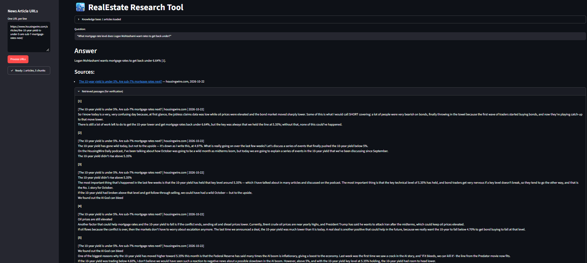

# 🏙️ Real Estate News Research Assistant (RAG)

Paste real estate news article URLs, ask a question, and get an answer with cited sources. Only the **main article text** is indexed (no menus, headers, footers or ads), and every answer links back to the articles it came from.



## Features

- **Clean ingestion:** downloads each URL, extracts only the article body (trafilatura, with a BeautifulSoup fallback), then removes leftover boilerplate lines and duplicates.
- **Context-aware chunks:** 900-character chunks (120 overlap), each prefixed with `title | site | date` so the model always knows which article and day a passage comes from.
- **Retrieval:** OpenAI embeddings stored in a persistent ChromaDB collection, searched with MMR (relevant *and* diverse passages).
- **Grounded answers:** the LLM answers only from the retrieved passages, cites them as `[1]`, `[2]`, and the UI lists the source articles and the exact passages used.
- **Clear failures:** blocked, paywalled or empty pages are skipped and shown with the reason.
- **Evaluation harness:** a RAGAS script scores answers on context precision, context recall, faithfulness and answer relevancy, and keeps a history of runs.

## How it works

```
pasted URLs -> download -> main-content extraction -> cleaning -> chunking (+ title/date header)
                                                                      |
                                                       OpenAI embeddings -> ChromaDB
                                                                      |
question -> MMR retrieval (15 candidates) -> top 5 passages -> GPT answer with [1][2] citations -> Streamlit
```

## Tech stack

| Part | Tool |
|---|---|
| UI | Streamlit |
| Orchestration | LangChain components (text splitter, Chroma, OpenAI) |
| Extraction | trafilatura, BeautifulSoup |
| Embeddings | OpenAI `text-embedding-3-small` |
| Vector store | ChromaDB (persisted in `data/chroma_db`) |
| LLM | OpenAI `gpt-4o-mini` (configurable) |
| Evaluation | RAGAS |
| Tooling | uv, pytest, Ruff |

## Quickstart

Requires [uv](https://docs.astral.sh/uv/) and an OpenAI API key. Python 3.11 is used.

```bash
git clone <your-repo-url>
cd real-estate-rag
uv sync
cp .env.example .env        # Windows: copy .env.example .env
# open .env and set OPENAI_API_KEY
uv run streamlit run app.py
```

## Usage

1. Paste one or more article URLs in the sidebar (one per line). Use links to full articles, not section or listing pages.
2. Click **Process URLs**. The app downloads, cleans and indexes them.
3. Ask a question, for example: *"What level did the 10-year Treasury yield fall to?"*
4. Read the answer, the source links, and (optionally) the retrieved passages used to produce it.

## Configuration

Set these in `.env` (defaults shown):

| Variable | Default | Purpose |
|---|---|---|
| `OPENAI_API_KEY` | none | Required |
| `LLM_MODEL` | `gpt-4o-mini` | Chat model |
| `EMBEDDING_MODEL` | `text-embedding-3-small` | Embeddings (do not change after indexing without re-indexing) |
| `CHUNK_SIZE` / `CHUNK_OVERLAP` | `900` / `120` | Chunking |
| `RETRIEVE_K` | `15` | Candidates fetched by MMR |
| `RERANK_TOP_N` | `5` | Passages sent to the LLM |
| `USE_RERANK` | `false` | Optional LLM reranking step (see Evaluation) |
| `RAGAS_JUDGE_MODEL` | same as `LLM_MODEL` | Judge model for evaluation |

## Project structure

```
real-estate-rag/
├── app.py                  # Streamlit UI only
├── config.py               # settings and defaults
├── pyproject.toml          # dependencies (uv)
├── rag/
│   ├── loader.py           # download + main-content extraction
│   ├── cleaner.py          # boilerplate removal, deduplication
│   ├── splitter.py         # chunking + contextual header
│   ├── embeddings.py       # OpenAI embeddings
│   ├── vectorstore.py      # Chroma create / load / reset
│   ├── retriever.py        # MMR retrieval (+ optional reranker)
│   ├── llm.py              # chat model factory
│   ├── prompts.py          # system prompt
│   └── pipeline.py         # ingest(urls) and answer(question)
├── scripts/
│   ├── evaluate.py         # quick keyword check
│   └── evaluate_ragas.py   # RAGAS evaluation + run history
└── tests/                  # unit tests and the evaluation dataset
```

## Evaluation

**Method.** `scripts/evaluate_ragas.py` runs every question through the real pipeline and scores the answers with [RAGAS](https://docs.ragas.io) using an LLM judge (`gpt-4o-mini`). The dataset in `tests/ragas_dataset.json` has 33 questions with reference answers written from the article text, covering 8 HousingWire articles. It includes single-article questions and questions that need two articles. One article has no questions on purpose, so retrieval has to ignore it.

- **Context precision:** are the useful passages ranked at the top?
- **Context recall:** do the retrieved passages contain the facts in the reference answer?
- **Faithfulness:** is every claim in the answer supported by the passages?
- **Answer relevancy:** does the answer address the question?

**Results** (final configuration: MMR retrieval, no reranker; 4 runs on the same index):

| Run | Prompt | Faithfulness | Context precision | Context recall | Answer relevancy |
|---|---|---|---|---|---|
| baseline-1 | rules 1-5 | 0.883 | 0.947 | 0.894 | 0.787 |
| baseline-2 | rules 1-5 | 0.909 | 0.923 | 0.970 | 0.801 |
| grounded-1 | rules 1-7 | 0.883 | 0.941 | 0.924 | 0.788 |
| grounded-2 | rules 1-7 | 0.840 | 0.949 | 0.894 | 0.795 |
| **Mean** | | **0.88** | **0.94** | **0.92** | **0.79** |

**What I learned**

- Scores vary by up to about ±0.04 between identical runs, because the judge is an LLM and the set has only 33 questions. Differences smaller than that are noise.
- Adding extra "grounding" rules to the prompt did not measurably change any metric.
- An optional LLM reranking step (`USE_RERANK=true`) showed no measurable gain on this dataset, so it is off by default.
- Early runs scored near zero because the input was a news *listing* page instead of articles. Always use full article URLs.

**Reproduce**

```bash
uv run python scripts/evaluate_ragas.py --label my-run --note "what changed"
uv run python scripts/evaluate_ragas.py --label my-run-2 --no-ingest --note "same index, second run"
uv run python scripts/evaluate_ragas.py --history
```

Use `--no-ingest` after the first run so every run scores the same indexed articles.

## Development

```bash
uv run pytest -q        # unit tests (no API key needed)
uvx ruff check .        # lint
```

## Limitations

- Paywalled or JavaScript-only pages cannot be extracted and are skipped with a reason.
- Answers are only as good as the articles you load. Check the cited sources.
- Evaluation scores come from an LLM judge on a small question set. They show direction, not exact accuracy.
- Respect each website's terms of service and robots.txt. Use this tool for personal or research purposes.

